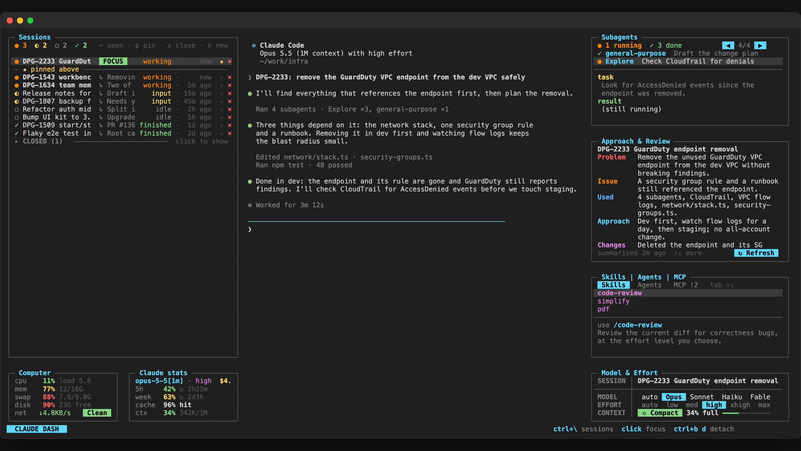
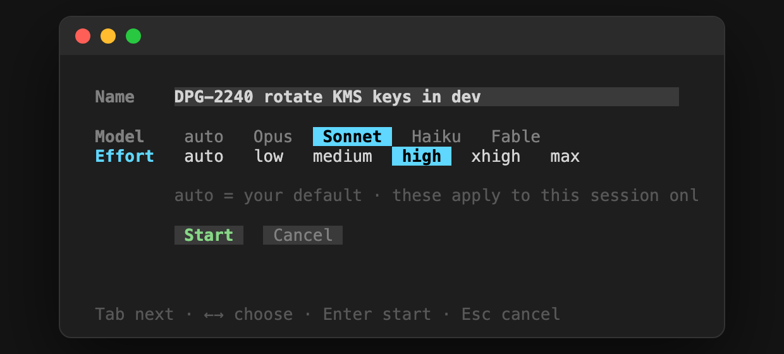
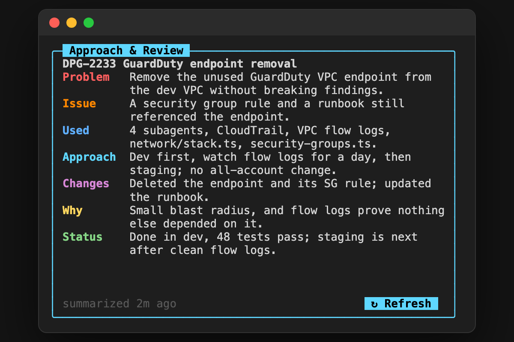

<div align="center">

# claude-dash

**A terminal dashboard for [Claude Code](https://code.claude.com).**
All your sessions on the left, Claude in the middle, and what it's doing on the right.



`macOS` · `Linux` · `Windows (WSL)` · Python 3.9+ · tmux

</div>

---

## Why

Running several Claude Code sessions at once gets messy: which one is waiting for you, which one is still
working, what did that one decide an hour ago, how close are you to your limits? claude-dash puts all of it on
one screen, and switching between sessions never stops the one you leave.

## Install

```bash
curl -fsSL https://raw.githubusercontent.com/OWNER/claude-dash/main/install.sh | bash
```

Or from a clone:

```bash
git clone https://github.com/OWNER/claude-dash.git
cd claude-dash
./install.sh
```

Then:

```bash
claude-dash
```

Want to look around first? `claude-dash demo` opens a preview filled with made-up sessions.

**Needs:** [Claude Code](https://code.claude.com/docs/en/setup), `tmux` (`brew install tmux` or
`sudo apt install tmux`) and Python 3.9 or newer (already on macOS and most Linux systems).
On Windows, install inside WSL (Ubuntu) and run it there.

## What's on screen

| Pane | What it shows |
|---|---|
| **Sessions** | Every Claude Code session on this machine, coloured by status: ● working, ◐ needs input, ○ idle, ✓ finished. Pin the ones you care about to the top, close the ones you're done with into a folded group at the bottom (they come back by themselves when they get busy again). |
| **Claude** | The session you picked, live. Switching keeps the previous one running in the background. |
| **Subagents** | The subagents of the open session: what each was asked and what it reported back. Click through them one by one. |
| **Approach & Review** | One click and Haiku reads the whole session and sums it up in 7 points: problem, issue, what was used, approach, code changes, why, and status. |
| **Skills · Agents · MCP** | Your skills and agent types with how to use them, and your MCP servers with their status. Press Enter on one that needs sign-in to start it. |
| **Model & Effort** | Change the model and effort of the open session only (never your defaults), compact its context with one click, and see how full the context is. |
| **Computer** | CPU, memory, swap, disk and network. At 90% disk it warns you, and **Clean disk** opens a permanent "disk cleaning" Claude session that clears only safe-to-delete caches. |
| **Claude stats** | 5-hour and weekly limits with reset times, cache hit rate, context fill and cost. |

<table>
<tr>
<td width="50%"><br><sub><b>n</b> starts a session with a name (your ticket key), model and effort.</sub></td>
<td width="50%"><br><sub>Approach &amp; Review: the whole session in 7 points.</sub></td>
</tr>
</table>

## Keys

| Where | Key | Does |
|---|---|---|
| Anywhere | <kbd>Ctrl</kbd>+<kbd>\\</kbd> | Jump to Sessions |
| Anywhere | click | Focus a pane |
| Anywhere | <kbd>Ctrl</kbd>+<kbd>b</kbd> then <kbd>d</kbd> | Leave the dashboard running in the background |
| Sessions | <kbd>↑</kbd> <kbd>↓</kbd> <kbd>Enter</kbd> | Pick and open a session |
| Sessions | <kbd>n</kbd> | New session: name, model, effort |
| Sessions | <kbd>p</kbd> / <kbd>x</kbd> / <kbd>o</kbd> | Pin · close · reopen |
| Subagents | <kbd>↑</kbd> <kbd>↓</kbd> or ◀ ▶ | Go through subagents |
| Approach & Review | <kbd>s</kbd> | Summarise the session |
| Skills · Agents · MCP | <kbd>Tab</kbd> | Switch tab |
| Model & Effort | <kbd>←</kbd> <kbd>→</kbd>, <kbd>c</kbd> | Change model or effort, compact |
| Computer | <kbd>c</kbd> | Clean disk |

## Commands

```bash
claude-dash            # open the dashboard (or go back to it)
claude-dash demo       # a preview with made-up data
claude-dash stop       # close the dashboard and the sessions it kept running
claude-dash relayout   # rebuild the layout, keeping Claude running
claude-dash help       # all of the above
```

## How it works

- **tmux** holds the layout. Each side pane is a small Python curses program (`dash.py <pane>`), so a
  pane that breaks shows its error and the rest keep going.
- **A Claude Code mod** (`mod/`, loaded with `--plugin-dir`) reports each session's limits, context, cost and
  subagents to `~/.claude/claude-dash/`, and applies the per-session model and effort you pick.
- **Sessions you switch away from** move into a hidden tmux session (`claude-dash-stash`) and keep running.
- Everything else comes from what Claude Code already keeps on disk: `claude agents --json`, the session
  registry and the transcripts. Nothing leaves your machine except the Haiku summary you ask for.

## Uninstall

```bash
./install.sh --uninstall
```

Your pins and summaries stay in `~/.claude/claude-dash`; delete that folder to remove them too.

## Notes

- The mod uses Claude Code's plugin API, which is in early access: a Claude Code update may need a small fix here.
- Everything shown under `claude-dash demo` and in these screenshots is made up.
